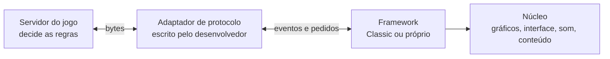
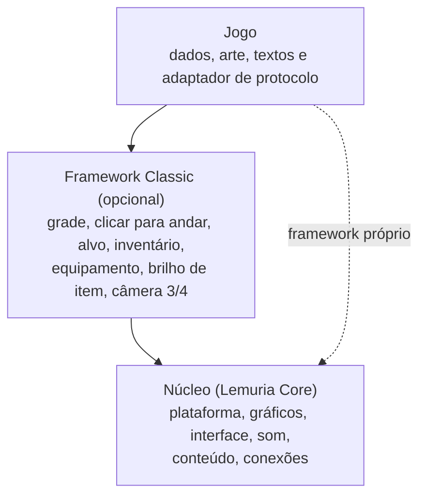
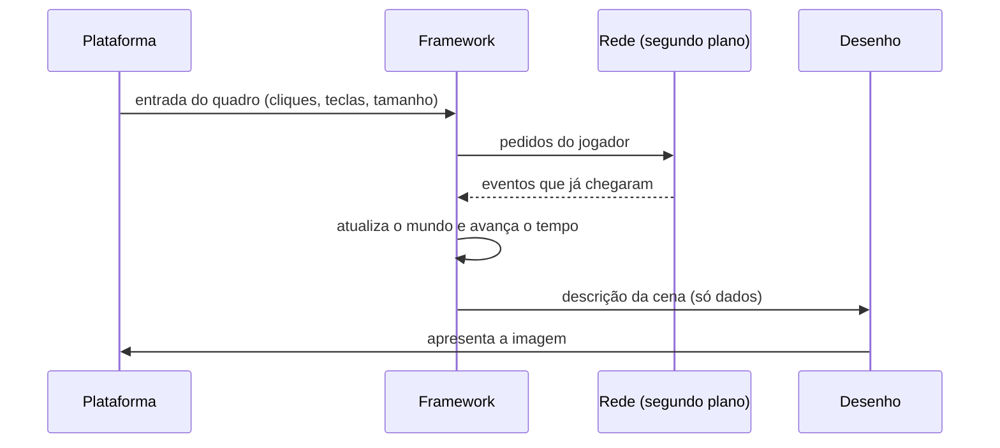

# Arquitetura

> Documento vivo: descreve como o sistema **é agora** e para onde vai. É atualizado no mesmo PR que muda o que ele descreve. Os porquês das decisões estão nos [ADRs](adr/README.md).
>
> **Como é agora (fatia 0):** a engine abre uma janela e desenha o chão em blocos e formas simples com a SDL GPU. O Classic tem a câmera 3/4, a grade, o cálculo de caminho, o clicar para andar, a sessão, o mundo, a antecipação e a correção. O Núcleo abre conexões TCP em segundo plano, e o jogo de demonstração conversa com o servidor de teste por um adaptador próprio. Conteúdo em arquivo, interface, som, luzes e efeitos ainda não existem: as seções sobre eles descrevem o destino.

## Visão geral

O Lemuria é um cliente de MMORPG: um terminal bonito e não confiável. O servidor de cada jogo decide as regras, e a engine mostra o resultado.



## Camadas



| Camada | Sabe | Não sabe |
|---|---|---|
| Núcleo | abrir janela, desenhar cenas, tocar som, carregar conteúdo, mostrar interface, abrir conexões e trocar bytes | o que é um item, uma espada ou uma party; o formato das mensagens de qualquer servidor |
| Classic | as mecânicas de cliente do gênero, configuradas por dados | nada de um jogo específico |
| Jogo | os números, os textos, a arte e como falar com o servidor escolhido | — |

As dependências só descem (INV-02). **O Classic não tem acesso especial ao Núcleo:** tudo o que ele usa é público, e um framework de terceiros consegue fazer o mesmo.

## Estrutura do repositório

As três camadas ficam visíveis na raiz do repositório ([ADR 0014](adr/0014-organizacao-do-repositorio.md)). Pastas com inicial maiúscula são o produto; pastas com inicial minúscula são a infraestrutura do repositório.

| Pasta | O que guarda | Alvos do build | Camada |
|---|---|---|---|
| `Engine/Source/Runtime/Core/` | a base da engine | `lemuria_core` | Núcleo |
| `Engine/Source/Runtime/PlatformSDL/` | a camada de plataforma | `lemuria_platform_sdl` | Núcleo |
| `Engine/Shaders/` | os shaders da engine, em HLSL, compilados no build para SPIR-V e DXIL ([ADR 0019](adr/0019-shaders-em-hlsl.md)) | compilados com `lemuria_platform_sdl` | Núcleo |
| `Frameworks/Classic/` | o framework oficial, opcional | `lemuria_classic` | Classic |
| `Samples/DemoGame/Source/Protocol/` | as mensagens da demonstração | `demo_protocol` | Jogo |
| `Samples/DemoGame/Source/Client/` | o jogo de demonstração: a biblioteca, que os testes usam sem abrir janela, e o programa com janela | `demo_client_lib` e `demo_client` | Jogo |
| `Samples/DemoGame/Source/TestServer/` | o servidor de teste: as regras e as conexões numa biblioteca, que os testes usam no mesmo processo, e o programa | `test_server_lib` e `test_server` | Jogo |
| `Samples/DemoGame/Source/TestSupport/` | o que os testes da demonstração com conexões reais compartilham | `demo_test_support` | Jogo |
| `tools/` | `dev.py` (o comando único) e `checks/` (as checagens) | — | Ferramentas |
| `tests/` | `architecture/` (o framework de exemplo, os programas com erro proposital para os sanitizers e o teste que conta a memória pedida pelo quadro) e `hooks/` (testes dos hooks) | — | Testes do repositório |
| `cmake/`, `docs/`, `templates/` | regras de build, documentos e modelos | — | Infraestrutura |

Todo módulo tem o mesmo formato:

```text
Core/
├─ Public/Lemuria/Core/   o que outros módulos podem usar
├─ Private/               detalhes internos
├─ Tests/                 os testes deste módulo
└─ CMakeLists.txt
```

Uma pasta só nasce quando tiver uso. Quando forem necessárias, estas pastas ficam em:

| Pasta | O que vai guardar |
|---|---|
| `Engine/Source/Programs/` | programas próprios da engine, como importadores de conteúdo |
| `Engine/Content/` | o conteúdo padrão da engine |
| `Samples/DemoGame/Content/` e `Samples/DemoGame/Config/` | a arte e as configurações do jogo de demonstração |
| `tests/visual/approved/` | as imagens que o dono aprovou como referência da [prova visual](VISUAL.md#prova-visual) |

Regras de dependência:

- O Núcleo não inclui nada do Classic; o Classic não inclui nada de jogo.
- Só `lemuria_platform_sdl` inclui o SDL (INV-09).
- As regras valem para todo arquivo de código, inclusive o `Main.cpp` dos programas.
- Um alvo novo só nasce quando existe um motivo real (ver a [regra de três](CONVENTIONS.md#regra-de-três)).

## O quadro

Um quadro é uma imagem da janela. A rede e a carga de arquivos trabalham em segundo plano e só colocam resultados em filas. **O quadro nunca espera por elas** (INV-04).



- **Atualizar e desenhar são separados.** O desenho recebe uma descrição da cena e não muda o estado do jogo (INV-03).
- **Tempo injetado.** O tempo do quadro e os sorteios visuais vêm de fontes que os testes controlam (INV-05).
- **Sem alocação depois de aquecer.** O quadro reutiliza a memória, e um teste mede isso (INV-13).
- **Animação independente do FPS.** Animações de taxa fixa são interpoladas para ficar suaves em qualquer taxa de quadros.

**Como é hoje, na demonstração:** a cada quadro, o programa lê a entrada da janela e transforma o clique no bloco sob o cursor. A `DemoGame` atualiza a sessão (o adaptador entrega o que a rede trouxe), move todos no mundo e envia o pedido de caminhada. Depois ela descreve a cena, a câmera acompanha o jogador e o desenho apresenta a imagem. A rede troca lotes inteiros com o quadro, e os lotes de envio reservam a memória desde o começo. Os passos entre ler a janela e desenhar ficam na `DemoFrame`, que o programa e o teste do quadro chamam do mesmo jeito. O teste em `tests/architecture/frame_allocations` conta a memória que o quadro aquecido pede e exige zero. O que esse contador ainda não vê está na [TD-0014](TECH_DEBT.md).

## Encaixes

Os encaixes são os pontos que o desenvolvedor pode trocar sem mexer na engine.

| Encaixe | O que o desenvolvedor fornece | ADR |
|---|---|---|
| Adaptador de protocolo | A tradução entre os bytes do servidor e os eventos do jogo | [0004](adr/0004-adaptador-de-protocolo.md) |
| Importadores de conteúdo | A leitura de formatos de arquivo além dos oficiais | [0005](adr/0005-conteudo-e-importadores.md) |
| Cifra de arquivos | A proteção dos pacotes de conteúdo do jogo dele | [0005](adr/0005-conteudo-e-importadores.md) |
| Framework | As mecânicas do jogo, se ele não quiser usar o Classic | [0002](adr/0002-tres-camadas.md) |

### Adaptador de protocolo

O contrato tem dois níveis:

1. **Núcleo: conexões e bytes.** Abre e fecha conexões, entrega os bytes recebidos e envia os bytes pedidos. Nunca interpreta o conteúdo (INV-07).
2. **Framework: eventos e pedidos.** O Classic define o vocabulário do gênero (alguém apareceu, alguém andou, pedir para andar). O adaptador traduz entre esse vocabulário e os bytes.

O desenho precisa aceitar servidores que funcionam de formas diferentes:

| Situação real | O que o contrato garante |
|---|---|
| O jogo passa por mais de uma conexão, em sequência (por exemplo, uma para a lista de servidores e outra para jogar) | O adaptador controla quando abrir e trocar de conexão |
| Cada servidor tem o próprio formato de mensagem e a própria criptografia | O adaptador recebe os bytes crus |
| O personagem começa a andar antes da resposta, e o servidor pode corrigir depois | O framework aceita antecipar o visual e reconciliar a correção (INV-01) |
| Uma mensagem chega antes de o mapa terminar de carregar | Os eventos ficam na fila até o mundo estar pronto para recebê-los |
| Dados inválidos ou maliciosos chegam da rede | O adaptador valida tudo antes de gerar um evento (INV-12) |

O contrato detalhado está no [ADR 0017](adr/0017-contrato-do-adaptador.md), e as conexões, no [ADR 0018](adr/0018-conexoes-de-rede.md). No código, o Núcleo oferece `Connections`: abrir, enviar, fechar e `poll`, que entrega o que aconteceu em cada conexão. O Classic oferece o `ProtocolAdapter`, o descritor de capacidades (`AdapterCapabilities`), os eventos (`GameEvent`), os pedidos (`GameRequest`) e a sessão (`GameSession`), que vai da conexão até o mundo. O adaptador da demonstração (`DemoAdapter`) é o exemplo completo.

O contrato é comparado com o fluxo real de um servidor externo em toda fatia que o alterar, e é provado por um adaptador de verdade na fatia 6 ([TD-0003](TECH_DEBT.md)).

## Conteúdo

- Modelos, animações, texturas, mapas e efeitos são **dados**. As definições ficam em texto versionado, e o build de conteúdo gera os formatos binários próprios da engine.
- A entrada oficial de modelos e animações é o **glTF 2.0**, o formato aberto que o Blender exporta.
- Importadores plugáveis permitem que o desenvolvedor traga outros formatos (INV-08).
- Um dado inválido é erro de validação no build de conteúdo, com uma mensagem clara. Em tempo de execução, nenhum arquivo é considerado confiável (INV-12).
- A carga acontece em segundo plano (INV-04).

## Gráficos

- **Plataforma:** janela, entrada, arquivos e GPU ficam atrás de `lemuria_platform_sdl`, com SDL3 e SDL GPU ([ADR 0006](adr/0006-sdl3-plataforma-e-graficos.md)).
- **Fronteira do desenho:** o jogo, o Classic e o Núcleo só conhecem a descrição da cena. A partir da fatia 2, só uma camada interna fala com a SDL GPU, para que a API gráfica possa ser trocada no futuro ([ADR 0020](adr/0020-fronteira-do-desenho.md)).
- **Destino da renderização:** forward+ (clustered forward), adequado a muita transparência aditiva e a muitas luzes pequenas.
- **Personagens:** skinning na GPU e desenho em lote (instancing) por peça de equipamento.
- **Efeitos:** partículas na GPU, com orçamento.
- **Escala:** menos detalhe para personagens, animações e efeitos distantes, e uma prioridade para decidir o que desenhar quando o orçamento acabar (INV-14).
- **Qualidade:** níveis baixo, médio e alto, com redução automática para segurar a meta de FPS.

**Como é hoje:** um único passe desenha o chão e as formas simples em lote. Luzes, sombras e efeitos chegam na fatia 2. Os testes de desenho rodam sem placa de vídeo na CI do Linux, com um renderizador por software, e a prova visual compara as imagens com uma tolerância medida ([ADR 0021](adr/0021-prova-visual-e-tolerancia.md)).

## Interface

- **Interface do jogo:** RmlUi, com data binding e skins, atrás de uma camada própria ([ADR 0007](adr/0007-interface.md)).
- **Ferramentas e depuração:** Dear ImGui. Nunca aparece para o jogador.
- O desenho da interface passa pelo renderizador da engine.

## Som

O som fica atrás da camada de plataforma. A biblioteca é decidida na fatia que trouxer o primeiro som.

## Servidor de teste

Um programa mínimo em `Samples/DemoGame/Source/TestServer/`, usado só nos testes e na demonstração ([ADR 0003](adr/0003-engine-so-de-cliente.md)). Ele fala o protocolo próprio da demonstração e implementa apenas o que as fatias precisam provar.

- **Como é hoje:** as regras e as conexões ficam na biblioteca `test_server_lib`, que os testes rodam no mesmo processo. O programa `test_server` é o que `py tools/dev.py demo` abre.
- Ele aceita conexões só do próprio computador e coloca cada jogador no bloco livre mais perto do centro do mapa.
- Ele confere cada pedido de caminhada (velocidade, passos vizinhos e blocos permitidos) e corrige o que recusar.
- Ele proíbe uma faixa de trilha que o cliente acredita ser livre, para a demonstração mostrar uma correção.

## Invariantes

Regras que nenhuma mudança pode violar. Sempre que possível, cada uma é garantida por teste, análise ou checagem automática.

| ID | Invariante | Garantia |
|---|---|---|
| INV-01 | O servidor decide. O cliente só pode antecipar o visual, e aceita a correção | testes do framework e revisão |
| INV-02 | As dependências só descem: Jogo → Classic → Núcleo. O Núcleo funciona sem o Classic | checagem de includes e um framework de exemplo que compila só com o Núcleo |
| INV-03 | Desenhar nunca muda o estado do jogo | a cena é só dados, e o desenho a recebe sem poder alterá-la; revisão |
| INV-04 | O quadro nunca espera por rede ou disco | testes e revisão |
| INV-05 | Tempo e sorteios visuais são injetados, para os testes serem repetíveis | funções proibidas e testes |
| INV-06 | Núcleo e Classic não têm nomes, números ou regras de um jogo específico | revisão e checagem de termos |
| INV-07 | O Núcleo não conhece o formato das mensagens: o adaptador controla bytes, criptografia e sequência de conexões | checagem de includes e revisão |
| INV-08 | Formatos de conteúdo entram por importadores plugáveis | testes e revisão |
| INV-09 | Só a camada de plataforma fala com o SDL e com o sistema operacional | checagem de includes e testes em Linux |
| INV-10 | O código compila em MSVC e Clang, e os testes rodam em Windows e Linux | CI nos dois sistemas |
| INV-11 | Memória com dono claro (RAII), sem `new` e `delete` soltos | clang-tidy, sanitizers e revisão |
| INV-12 | Todo dado de rede ou de arquivo é validado antes do uso | testes com dados inválidos, sanitizers e revisão |
| INV-13 | Depois de aquecido, o quadro não aloca memória | teste que conta as alocações do quadro |
| INV-14 | Personagens, partículas e efeitos têm orçamento, e a qualidade cai antes do FPS | testes de orçamento e medição do cerco |
| INV-15 | Nenhum segredo entra no repositório | hook de pre-commit e detecção do GitHub |
| INV-16 | Nada de nomes de conteúdo, assets, formatos, protocolo ou código de outros jogos. Só licenças compatíveis com a MIT | checagem de termos e revisão |
