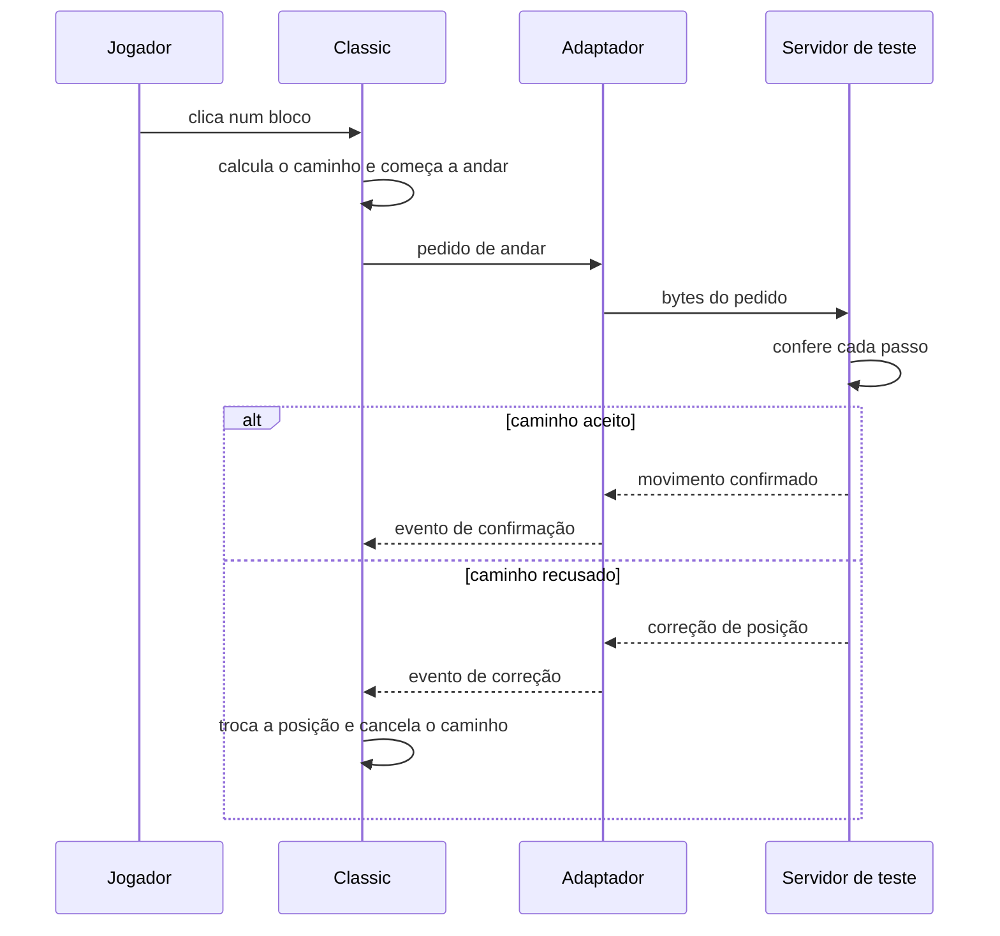
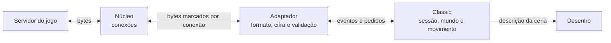

# Plano da fatia 0: Primeiros passos

## Resumo para o dono

A fatia é construída em seis etapas, e cada uma termina com algo que pode ser verificado: primeiro as ferramentas, depois o desenho, a prova visual, as regras de rede, o servidor e, por fim, o jogo completo. Ela precisa de duas ferramentas novas e de mudanças em algumas travas, listadas abaixo com o motivo de cada uma.

## Abordagem

| Etapa | O que é construído | Como se sabe que terminou |
|---|---|---|
| 1. Fundações | Bibliotecas novas, ajustes nas travas e ADRs | `py tools/dev.py verify` passa com tudo instalado |
| 2. Desenho | Matemática, tempo injetado, descrição da cena, janela, shaders, câmera e chão | A janela mostra o chão em blocos com Direct3D 12 e Vulkan |
| 3. Prova visual | Cena de prova, imagem em arquivo, medição, comparação, medidor de fluidez e teste de alocação | `py tools/dev.py visual` gera a imagem, e a IA abre e avalia o resultado |
| 4. Contrato e mundo | Conexões no Núcleo; sessão, mundo, caminho, antecipação e correção no Classic | Os cenários de servidor "mal-educado" passam com um adaptador de teste |
| 5. Protocolo e servidor | Mensagens da demonstração, leitura validada e servidor de teste | Testes com dados inválidos e com caminhos ilegais passam |
| 6. Jogo completo | Adaptador da demonstração, cliente com janela e `py tools/dev.py demo` | Dois clientes se veem por conexão de rede real |

A ordem coloca o maior risco técnico (o desenho pela SDL GPU e a prova visual) antes da lógica de rede, que não depende de placa de vídeo.

## Alvos e módulos afetados

| Alvo do build | O que muda |
|---|---|
| `lemuria_core` | Matemática, relógio do quadro, sorteio injetado, descrição da cena, estatísticas de fluidez e interface de conexões por bytes, com tipos de conexão e opções de entrega |
| `lemuria_platform_sdl` | Janela, entrada, relógio real, desenho com a SDL GPU, shaders, imagem em arquivo e conexões TCP em segundo plano |
| `lemuria_classic` | Grade, cálculo de caminho, câmera 3/4, sessão, mundo, antecipação e correção, vocabulário de eventos e pedidos e contrato do adaptador |
| `demo_protocol` | Mensagens da demonstração, enquadramento e leitura com limites |
| `demo_client` e `demo_client_lib` (novo) | Adaptador, paleta, mapa da demonstração, cena de prova e programa com janela. A biblioteca nova existe para que os testes usem o cliente sem abrir janela |
| `test_server` e `test_server_lib` (novo) | Regras do servidor de teste. A biblioteca nova permite o teste de ponta a ponta |
| `Engine/Shaders/` (pasta nova) | Shaders do chão e das formas |

## Visão de destino

| Peça | Agora | No destino | Por que nenhuma porta se fecha |
|---|---|---|---|
| Contrato do adaptador | Bytes no Núcleo; eventos, pedidos e capacidades no Classic | O mesmo contrato, com adaptadores de servidores reais | O contrato fica na fronteira de bytes e eventos, a única que serve para qualquer servidor |
| Conexões | TCP com SDL3_net, atrás de uma interface do Núcleo | TCP e GNS como opções, com o GNS num módulo separado e opcional | O adaptador escolhe o tipo de conexão, e o Classic e os jogos só conhecem a interface do Núcleo |
| Sessão | Enumera todas as fases, mas a demonstração passa só por conectar, entrar e estar no mundo | Login, escolha de personagem, troca de mapa e reconexão | As fases já existem no vocabulário, e o adaptador decide quais usa |
| Descrição da cena | Lista de blocos e formas, só com dados | Malhas, materiais, luzes e efeitos | O desenho continua recebendo só dados (INV-03) |
| Desenho | Um único passe, com desenho em lote (instancing) | Forward+, skinning na GPU, luzes e efeitos | O lote por instância é a mesma base usada para personagens em grande número |
| Shaders | HLSL compilado no build para SPIR-V e DXIL | O mesmo processo, com mais shaders | Um único código-fonte atende às duas APIs gráficas |
| Mapa | Gerado por código, com sorteio fixo | Conteúdo em arquivo, com o build de conteúdo | O Classic recebe uma grade pronta e não sabe de onde ela veio |
| Prova visual | Uma cena e faixas parciais | Uma cena por clima e todas as faixas | A medição e a comparação não dependem do que está na cena |

## Simplificações provisórias

| Item provisório | Por que é provisório | Destino |
|---|---|---|
| O mapa da demonstração é gerado por código | o formato de mapa e o build de conteúdo ainda não existem | fatia 2 |
| O desenho usa um único passe, sem luzes | as luzes chegam com o clima | fatia 2 |
| O código de desenho fala direto com a SDL GPU (TD-0009) | a separação só se justifica quando existir mais de uma forma de desenhar | fatia 2 |
| A demonstração não tem login nem escolha de personagem | só um servidor real justifica esse fluxo | fatia 6 |
| Uma queda de conexão encerra a sessão, sem reconexão automática | a política de retomada depende do servidor real | fatia 6 |
| O sinal de presença é declarado nas capacidades, mas não é enviado | o servidor de teste não exige esse sinal | fatia 6 |
| O adaptador da demonstração escreve o próprio enquadramento, e as peças prontas e o kit de conformidade ficam para depois | pela regra de três, a abstração só nasce com um segundo adaptador real | fatia 6 |
| A fluidez é medida na build de desenvolvimento, sem otimização | ainda não existe uma configuração de release | fatia de escala |

O personagem como forma simples já está registrado na [TD-0001](../../docs/TECH_DEBT.md). Esta fatia resolve a TD-0005, a TD-0007 e a TD-0008.

## Decisões e dependências

### Bibliotecas novas (precisam da aprovação do dono)

| Biblioteca | Licença | Para quê | Entra no jogo distribuído | Por que esta |
|---|---|---|---|---|
| `sdl3-net` 3.2.0 | Zlib | Conexões TCP | sim | É da mesma família da SDL, pequena e não depende de código separado para cada sistema |
| `shaderc` | Apache-2.0 | Compilar shaders para SPIR-V durante o build | não | Tem licença aberta e funciona no Windows e no Linux. O DXIL, usado pelo Direct3D 12, é gerado pelo `dxc` que já vem no Windows SDK |

O plano aprovado previa o `directx-dxc`. O dono aprovou a troca pelo `shaderc` em 2026-11-18, porque o pacote de Windows daquela ferramenta traz termos da Microsoft que limitam o uso ao Windows e preveem coleta de dados de uso.

### ADRs novos

| ADR | Decisão |
|---|---|
| 0017 | Contrato do adaptador de protocolo |
| 0018 | Conexões TCP com SDL3_net, o caminho para oferecer também o GNS, e o servidor de teste usando a camada de plataforma |
| 0019 | Shaders em HLSL, compilados no build para SPIR-V com o `shaderc` e para DXIL com o `dxc` do Windows SDK (decisão prevista no [ADR 0006](../../docs/adr/0006-sdl3-plataforma-e-graficos.md)) |
| 0020 | Fronteira do desenho e troca futura da API gráfica, aprovada pelo dono durante a fatia |
| 0021 | Onde a prova visual roda, qual é a tolerância da comparação e como a TD-0005 se resolve |

### Mudanças nas travas (precisam da aprovação do dono)

| Trava | Mudança | Por que é necessária | Efeito na proteção |
|---|---|---|---|
| `vcpkg.json` | Adiciona as duas bibliotecas | A rede e os shaders dependem delas | Neutro |
| `tools/checks/lemuria_checks/architecture_check.py` | O servidor de teste passa a poder usar a camada de plataforma | Ele precisa de TCP e de relógio real, e a regra atual proíbe o sistema operacional e a plataforma ao mesmo tempo, sem deixar caminho | **Afrouxa um ponto:** SDL, sistema operacional e Classic continuam proibidos para o servidor |
| `tools/checks/lemuria_checks/architecture_check.py` | A checagem de SDL passa a reconhecer também o SDL3_net | Hoje o cabeçalho dele passaria despercebido | Reforça |
| `tools/checks/lemuria_checks/cpp_rules_check.py` | Libera `new` e `malloc` só na pasta do contador de alocações | Contar alocações exige substituir a função que aloca memória | **Afrouxa um ponto:** vale para uma única pasta, como já acontece com os testes dos sanitizers |
| `tests/architecture/frame_allocations/` (novo) | Teste que conta as alocações do quadro | Prova o INV-13 (TD-0008) | Reforça |
| `tools/checks/` (novo módulo e testes) | Medição dos números da imagem e comparação com a imagem aprovada | A prova visual fica protegida como trava | Reforça |
| `tools/dev.py` | Comandos `visual` e `demo`; o `gpu-test` passa a rodar também a prova visual | Dá ao dono comandos prontos e leva a prova à CI do Linux sem mudar o `ci.yml` | Reforça |

Cada mudança que afrouxa um ponto vem com um teste provando que o resto da regra continua recusando o que deve.

### Contrato do adaptador de protocolo (precisa da aprovação do dono)

O contrato segue os dois níveis do [ADR 0004](../../docs/adr/0004-adaptador-de-protocolo.md):

- **Núcleo:** abre várias conexões, cada uma com identidade própria que nunca se repete. Entrega blocos de bytes de qualquer tamanho, envia na ordem pedida e marca tudo com a conexão de origem.
- **Classic:** define fases da sessão, eventos, pedidos e o descritor de capacidades.
- **Adaptador:** decide quantas conexões existem e quando trocar de uma para outra, cuida do formato das mensagens e da cifra, valida tudo o que recebe e traduz bytes em eventos.

**Mais de um tipo de conexão.** O GNS não substitui o TCP, porque só conversa com quem também usa GNS. As duas opções convivem, e o tipo de conexão é uma característica de cada servidor. O GNS não é instalado nesta fatia, mas o contrato já nasce preparado para ele:

| Diferença entre os tipos | Como o contrato trata |
|---|---|
| O TCP entrega um fluxo de bytes, e o GNS entrega mensagens inteiras | O Núcleo entrega blocos de bytes e informa se cada bloco é uma mensagem inteira |
| O GNS permite envio sem garantia de chegada | O envio tem uma opção de garantia, e o padrão é "tudo chega, em ordem" |
| Nem todo tipo de conexão atende a todas as opções | Cada tipo publica o que oferece, e um pedido que ele não atende devolve um erro claro |
| Cada tipo tem limites próprios de tamanho de mensagem | O limite faz parte do que cada tipo publica |
| Cada biblioteca tem os próprios códigos de queda | O Núcleo usa motivos neutros e guarda o código original para diagnóstico |
| Um servidor usa um único tipo de conexão | O adaptador declara o tipo no descritor de capacidades |

**Comparação com o fluxo de um servidor real.** A lição lista 50 requisitos, agrupados aqui:

| Grupo (requisitos da lição) | Na fatia 0 | Depois |
|---|---|---|
| Conexões e sessão (1 a 8) | 1 a 6 | 7 e 8, sobre login e retomada, na fatia 6 |
| Bytes e mensagens (9 a 14) | todos; a cifra fica interna ao adaptador | — |
| Entrada no mapa (15 a 22) | todos, com testes automáticos para a troca de mapa | a demonstração com dois mapas, na fatia 6 |
| Movimento (23 a 30) | todos | — |
| Outras entidades (31 a 39) | todos | — |
| Tempo e presença (40 a 43) | 42, e o sinal declarado nas capacidades | 40, 41 e 43 na fatia 6 |
| Limites e robustez (44 a 47) | todos | — |
| Capacidades e conformidade (48 a 50) | 48 e 49, e os cenários como testes do Classic | o kit de conformidade empacotado, na fatia 6 |

**Cenários de servidor "mal-educado" testados nesta fatia:** recusar sem responder, encurtar o caminho em silêncio, enviar resposta atrasada depois de uma correção, reaproveitar um número, enviar evento sobre número desconhecido, mandar objetos durante o carregamento, recusar uma troca de mapa, derrubar a conexão em cada fase, ficar em silêncio sem fechar e alterar a grade durante o jogo. O cenário de recusar a reconexão fica para a fatia 6.

**Onde este plano difere da lição:** ela recomenda entregar logo peças prontas para o adaptador. O Lemuria mantém o contrato da fronteira de bytes e eventos, mas adia essas peças até existir um segundo adaptador real, seguindo a [regra de três](../../docs/CONVENTIONS.md#regra-de-três).

### Formatos de conteúdo

Nenhuma mudança.

## Lições da central usadas

- Fluxo de sessão em MMORPG clássico em grade e o contrato de um adaptador de protocolo (2026-11-18).

## Riscos

| Risco | Como o plano reduz |
|---|---|
| A fatia é grande | As seis etapas têm entregas próprias. Se uma etapa revelar trabalho demais, a IA para e propõe dividir a fatia |
| Duas ferramentas compilam o mesmo shader e podem gerar resultados diferentes | A prova visual compara as imagens do Direct3D 12 e do Vulkan (CA-22) |
| A versão do `dxc` depende do Windows SDK instalado, que o repositório não fixa | O build recusa com uma mensagem clara quando não encontra o `dxc`, e os shaders usam só recursos básicos |
| Placas de vídeo diferentes geram imagens um pouco diferentes | A tolerância é medida entre Direct3D 12, Vulkan e o renderizador por software, e justificada no ADR 0021 |
| O Windows da CI não tem placa de vídeo, e a SDL GPU não oferece um renderizador por software para o Direct3D 12 | A prova roda na CI do Linux e, no Windows, na máquina de desenvolvimento |
| O contador de alocações pode entrar em conflito com os sanitizers | O teste roda na build normal. Se não puder rodar com sanitizers, o motivo fica registrado no ADR 0021 e no report |
| Teste com rede real pode falhar de forma intermitente | Portas livres procuradas numa faixa reservada aos testes, porque o SDL3_net não informa a porta escolhida pelo sistema, somente no próprio computador, e espera por condição com limite |
| A conexão de teste só imita o GNS e pode não revelar tudo o que a biblioteca real exige | O contrato cobre as diferenças conhecidas, e a integração real terá ADR e testes próprios ([P-0003](../../docs/PROPOSALS.md)) |
| O contrato pode servir só para o servidor de teste | Os cenários "mal-educados" e os dois adaptadores com capacidades diferentes testam casos que o servidor de teste não produz. A prova final continua sendo a fatia 6 ([TD-0003](../../docs/TECH_DEBT.md)) |

## Testes

| Critério | Como é provado |
|---|---|
| CA-01 | teste automático da câmera em `Frameworks/Classic/Tests` e verificação manual da janela |
| CA-02 | teste automático em `Frameworks/Classic/Tests` |
| CA-03 | teste automático em `Frameworks/Classic/Tests` |
| CA-04 | teste automático em `Frameworks/Classic/Tests`, com tempo injetado |
| CA-05 a CA-07 | testes automáticos em `Frameworks/Classic/Tests`, com adaptador de teste |
| CA-08 | teste automático em `Samples/DemoGame/Source/TestServer/Tests` |
| CA-09 | teste automático de ponta a ponta em `Samples/DemoGame/Source/Client/Tests` e verificação manual |
| CA-10 e CA-11 | testes automáticos em `Samples/DemoGame/Source/Protocol/Tests` e `Samples/DemoGame/Source/Client/Tests` |
| CA-12 e CA-13 | testes automáticos em `Frameworks/Classic/Tests` |
| CA-14 | testes automáticos em `Engine/Source/Runtime/PlatformSDL/Tests` e `Frameworks/Classic/Tests`, e verificação manual |
| CA-15 | teste automático em `Frameworks/Classic/Tests` |
| CA-16 | testes automáticos em `Frameworks/Classic/Tests`, com a conexão de teste, e em `Engine/Source/Runtime/PlatformSDL/Tests`, com o TCP |
| CA-17 | teste automático em `Engine/Source/Runtime/PlatformSDL/Tests` |
| CA-18 | teste automático em `tests/architecture/frame_allocations` |
| CA-19 | teste automático com a etiqueta `gpu` em `Samples/DemoGame/Source/Client/Tests` |
| CA-20 e CA-21 | testes em `tools/checks/tests` e verificação manual com `py tools/dev.py visual` |
| CA-22 | verificação manual no Windows, com os dois drivers, e `gpu-test` na CI do Linux |
| CA-23 | teste automático das estatísticas em `Engine/Source/Runtime/Core/Tests` e verificação manual com `py tools/dev.py visual` |

## Diagramas

Como um clique vira movimento:

Quem conhece o quê:

